# Tutorial: The Cloud Storage Service in Swagger UI

This walks through every operation of the service against a real Dropbox account, using the interactive API docs FastAPI serves at `/docs` (Swagger UI). Each step states what we expect, shows what actually happened, and includes a screenshot of the request and the live response.

The steps run in order and build on each other. They work inside one scratch folder, `/ospsd-tutorial`, which the last step deletes, so your Dropbox ends up unchanged.

| Section | Operations | Presented by |
|---|---|---|
| [Create](#1-create) | upload, create folder, copy | Zesan Rahman |
| [Read](#2-read) | metadata, download, list, search | Jing Qian |
| [Update](#3-update) | rename, move | Shreyas Kaldate |
| [Delete](#4-delete) | delete | Ashik John |

All screenshots were captured from one run on October 21, 2026, against a real Dropbox test account. IDs, sizes and timestamps will differ in your run; status codes and error bodies should match.

## 0. Setup

1. Follow the [README setup](README.md#project-setup): install `uv`, run `uv sync --all-packages --extra dev`, create `.env`, and log in to Dropbox once:
   ```bash
   uv run python -m dropbox_client_impl login
   ```
2. Start the service:
   ```bash
   uv run uvicorn cloud_storage_service.app:app
   ```
3. Open **http://127.0.0.1:8000/docs**. For each step below: expand the operation, click **Try it out**, enter the values shown, and click **Execute**. Swagger shows the equivalent `curl` command above each response, so every step can also be repeated from a terminal.
4. Have two small text files ready to upload. We used `report.txt` (27 bytes) and a revised `report-v2.txt` (37 bytes).

### How errors look

Every failure uses the same body, whichever operation it comes from:

```json
{"error": {"code": "<code>", "message": "<what went wrong>"}}
```

| Status | `code` | Meaning |
|---|---|---|
| `403` | `permission_denied` | Dropbox does not allow the operation on this entry |
| `404` | `not_found` | Nothing exists at the path |
| `409` | `conflict` | The destination is already taken |
| `422` | `invalid_input` | The request is invalid (bad path, folder into itself, …) |
| `502` | `provider_failure` | Dropbox failed; details are logged, not returned |
| `503` | `provider_unavailable` | Dropbox is unreachable or busy; try again later |

The full mapping is in [`src/cloud_storage_service/README.md`](src/cloud_storage_service/README.md#shared-error-format).

---

## 1. Create

*Presented by Zesan Rahman.* Upload a file, create a folder, and copy, including what happens when the destination is already taken.

### 1.1 Upload a new file → `200`

`POST /files/upload` with `file` = `report.txt`, `remote_path` = `/ospsd-tutorial/Docs/report.txt`, `overwrite` = `false`.

- **Expected:** `200` and the new file's metadata. The missing folders `/ospsd-tutorial/Docs` are created automatically.
- **Actual:** `200`, `"path": "/ospsd-tutorial/Docs/report.txt"`, `"size": 27`, `"id": "id:OqsTuff5gbwAAAAAAAAC7g"`.


### 1.2 Upload to a taken path without `overwrite` → `409`

Same request, but with `file` = `report-v2.txt` and `overwrite` still `false`.

- **Expected:** `409 conflict`; the file in Dropbox is not replaced.
- **Actual:** `409`, `{"error": {"code": "conflict", "message": "Something already exists at '/ospsd-tutorial/Docs/report.txt'"}}`.

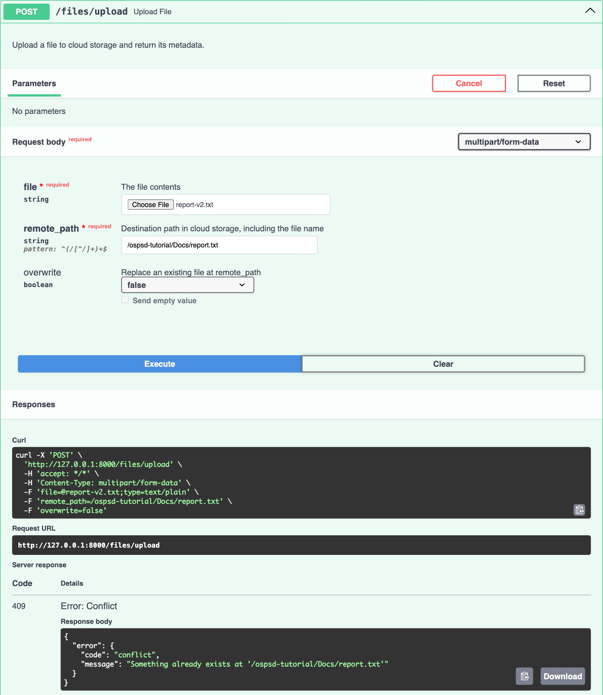

### 1.3 Upload again with `overwrite` = `true` → `200`

- **Expected:** `200`; the file is replaced but keeps the same `id`.
- **Actual:** `200`, `"size": 37` (the revised file), and the same `"id": "id:OqsTuff5gbwAAAAAAAAC7g"` as in 1.1.

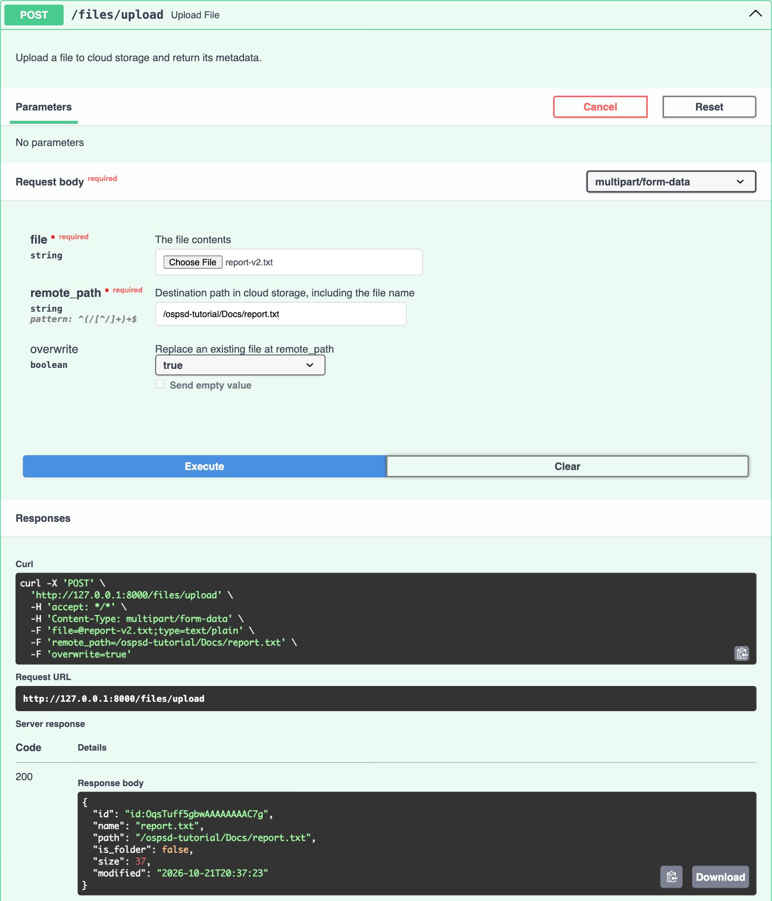

### 1.4 Create a folder → `200`

`POST /folders/create` with `{"remote_path": "/ospsd-tutorial/Archive"}`.

- **Expected:** `200`; a folder has `size` and `modified` set to `null`.
- **Actual:** `200`, `"is_folder": true`, `"size": null`, `"modified": null`.


### 1.5 Create the same folder again → `409`

- **Expected:** `409 conflict`.
- **Actual:** `409`, `"Something already exists at '/ospsd-tutorial/Archive'"`.

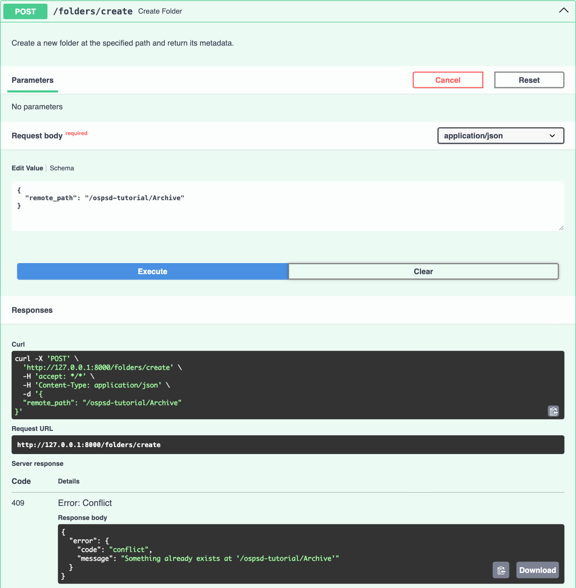

### 1.6 Copy a file → `200`

`POST /files/copy` with `{"from_path": "/ospsd-tutorial/Docs/report.txt", "to_path": "/ospsd-tutorial/Archive/report-copy.txt"}`.

- **Expected:** `200`; the copy is a new entry with its own `id`, and the source stays in place.
- **Actual:** `200`, `"path": "/ospsd-tutorial/Archive/report-copy.txt"`, `"id": "id:OqsTuff5gbwAAAAAAAAC8g"` (different from the source's).

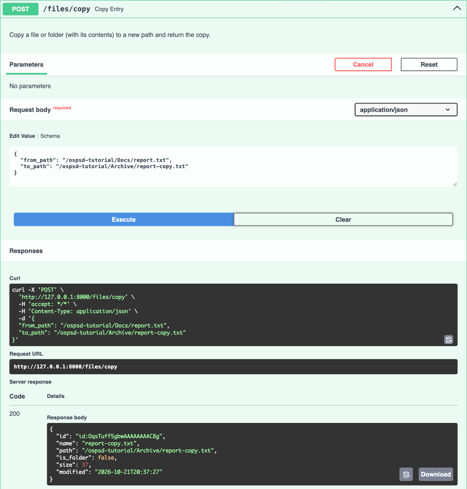

### 1.7 Copy a folder into itself → `422`

`POST /files/copy` with `{"from_path": "/ospsd-tutorial/Docs", "to_path": "/ospsd-tutorial/Docs/Backup"}`.

- **Expected:** `422 invalid_input`; nothing is copied. Dropbox reports this case with the same error as "destination is the source itself", so the service checks it before calling Dropbox (see [`docs/engineering-decision.md`](docs/engineering-decision.md)).
- **Actual:** `422`, `"Cannot copy '/ospsd-tutorial/Docs' into itself: '/ospsd-tutorial/Docs/Backup' is inside the source"`.

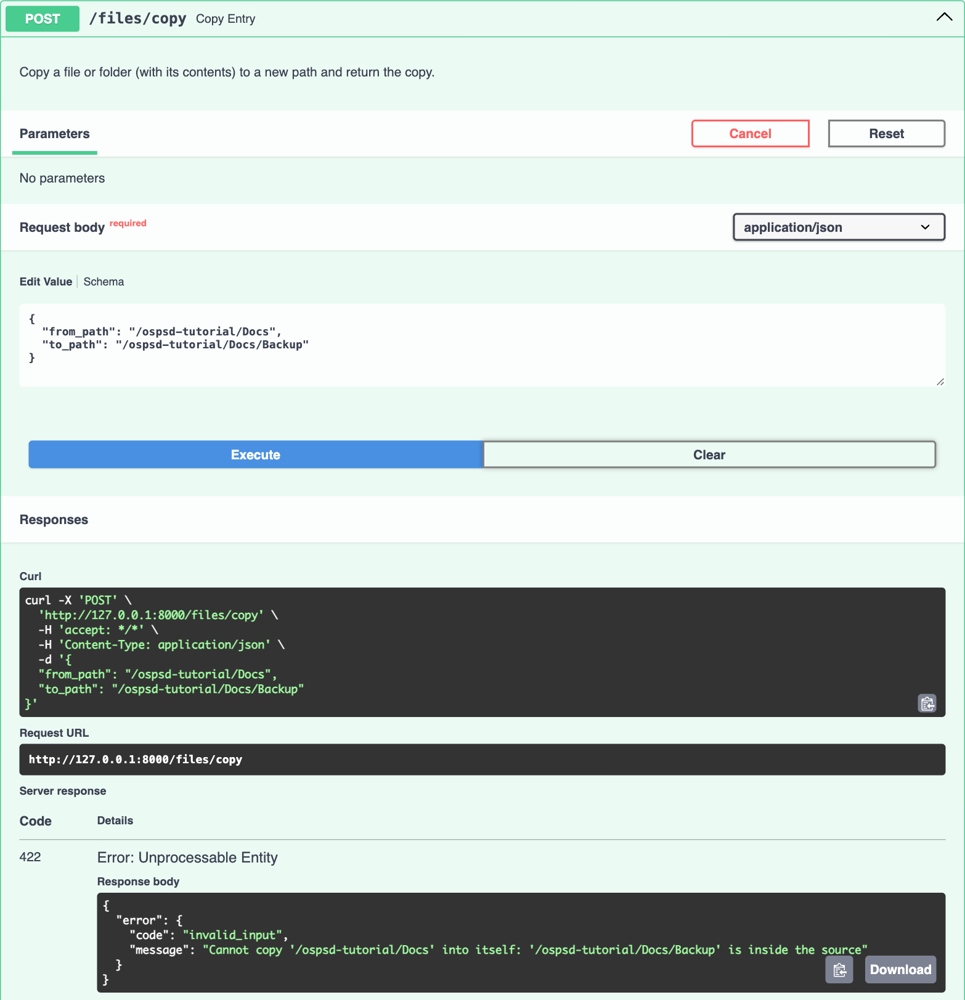

---

## 2. Read

*Presented by Jing Qian.*

> **To be completed by Jing.** Run these steps at this point in the walkthrough, after section 1, while `/ospsd-tutorial/Docs/report.txt` (37 bytes) and `/ospsd-tutorial/Archive/report-copy.txt` exist. Suggested steps, each with **Expected**, **Actual** and a Swagger screenshot saved in `docs/images/tutorial/read-*.png`:
>
> - [ ] `GET /files/metadata` for `/ospsd-tutorial/Docs/report.txt` → `200`, then for a missing path → `404`
> - [ ] `GET /files/download` for `/ospsd-tutorial/Docs/report.txt` → `200` with the uploaded bytes; compare them with `report-v2.txt`
> - [ ] `GET /folders/list` for `/ospsd-tutorial/Archive` → `200` listing `report-copy.txt`
> - [ ] `GET /files/search` with `q` = `report` → `200`
> - [ ] One failure case, e.g. downloading a folder

---

## 3. Update

*Presented by Shreyas Kaldate.* Rename and move change an existing entry; they never create one or overwrite another.

### 3.1 Rename a file → `200`

`POST /files/rename` with `{"path": "/ospsd-tutorial/Docs/report.txt", "new_name": "summary.txt"}`.

- **Expected:** `200`; the file stays in `Docs` and keeps its `id`.
- **Actual:** `200`, `"path": "/ospsd-tutorial/Docs/summary.txt"`, same `"id": "id:OqsTuff5gbwAAAAAAAAC7g"` as the uploaded file.

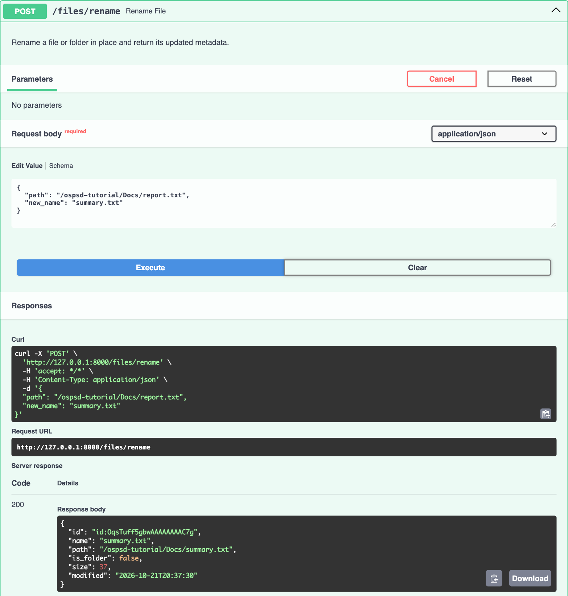

### 3.2 Move it into another folder → `200`

`POST /files/move` with `{"from_path": "/ospsd-tutorial/Docs/summary.txt", "to_path": "/ospsd-tutorial/Archive/summary.txt"}`.

- **Expected:** `200`; same entry, new path.
- **Actual:** `200`, `"path": "/ospsd-tutorial/Archive/summary.txt"`, same `id`.

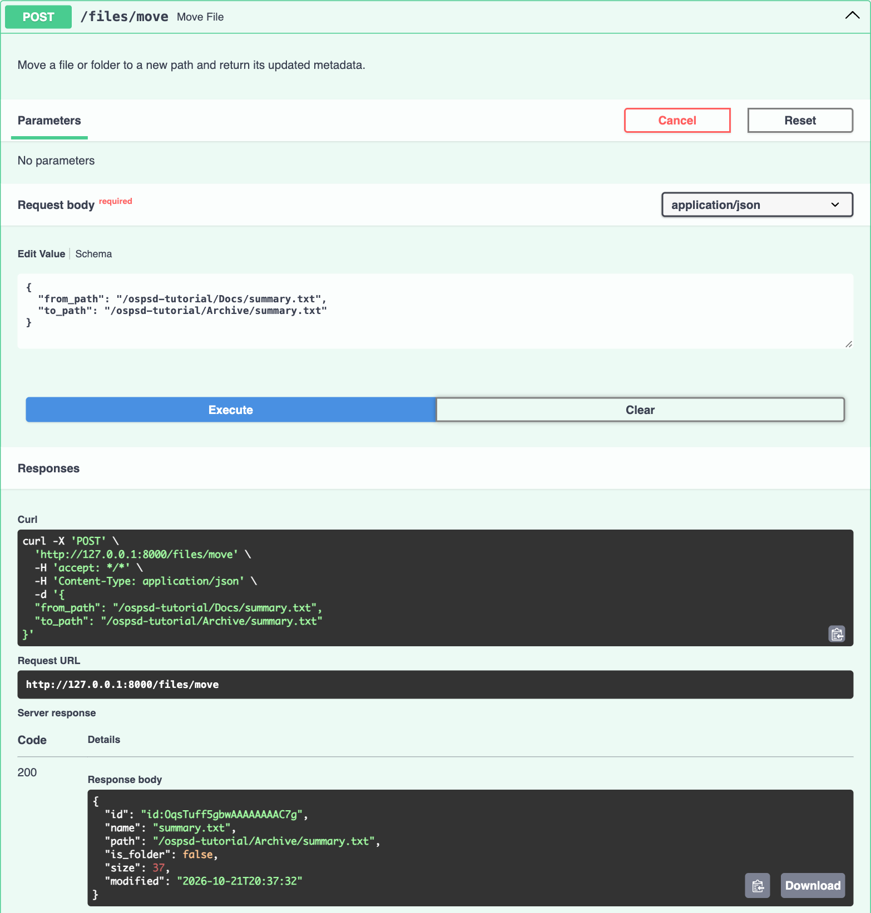

### 3.3 Repeat the same move → `404`

- **Expected:** `404 not_found`, since nothing is left at the source. This is also why retrying a move is safe: a repeat never moves anything twice.
- **Actual:** `404`, `"No file or folder at '/ospsd-tutorial/Docs/summary.txt'"`.


### 3.4 Rename onto a name that is taken → `409`

`POST /files/rename` with `{"path": "/ospsd-tutorial/Archive/summary.txt", "new_name": "report-copy.txt"}`. `report-copy.txt` already exists in `Archive` from step 1.6.

- **Expected:** `409 conflict`; neither file changes.
- **Actual:** `409`, `"Something already exists at '/ospsd-tutorial/Archive/report-copy.txt'"`.

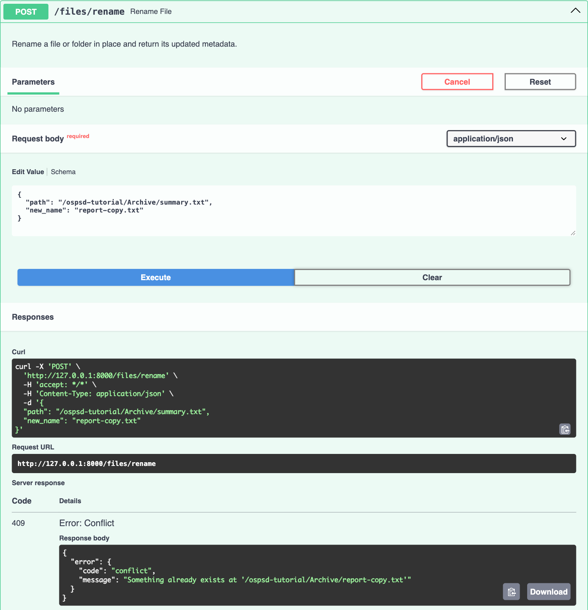

### 3.5 Move a folder into itself → `422`

`POST /files/move` with `{"from_path": "/ospsd-tutorial/Archive", "to_path": "/ospsd-tutorial/Archive/Old"}`.

- **Expected:** `422 invalid_input`; nothing moves.
- **Actual:** `422`, `"Cannot move '/ospsd-tutorial/Archive' into itself: '/ospsd-tutorial/Archive/Old' is inside the source"`.

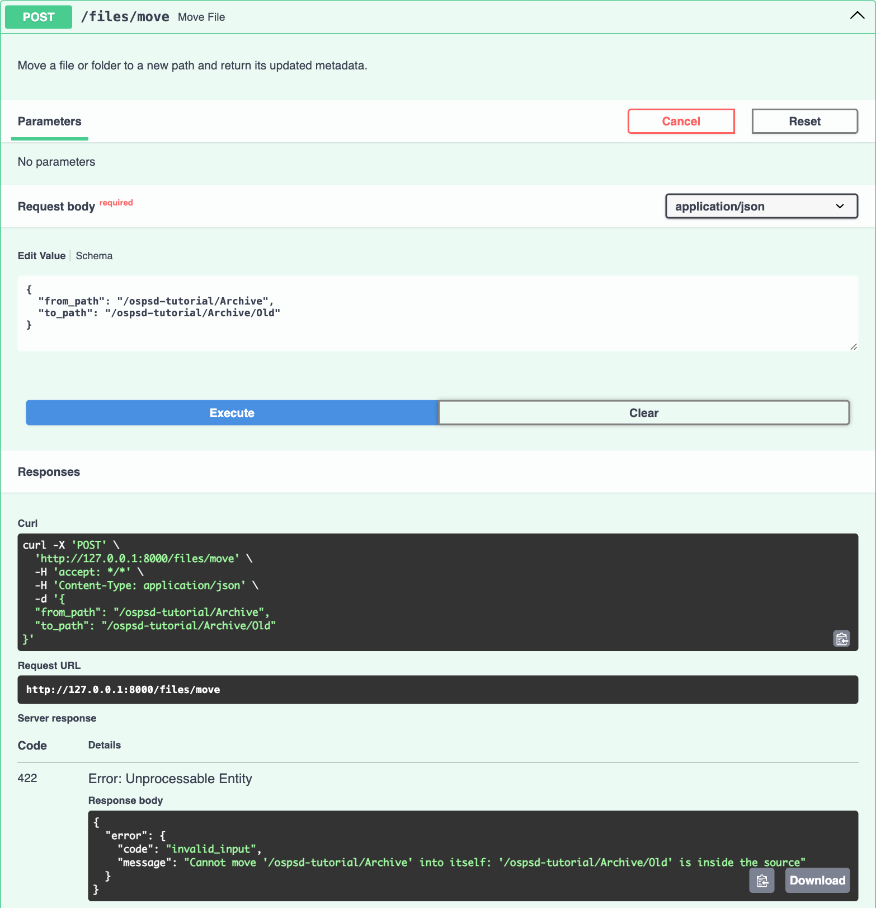

---

## 4. Delete

*Presented by Ashik John.* Deleted entries go to the Dropbox account's trash.

### 4.1 Delete a file → `204`

`DELETE /files` with `path` = `/ospsd-tutorial/Archive/report-copy.txt`.

- **Expected:** `204` with no body.
- **Actual:** `204`.

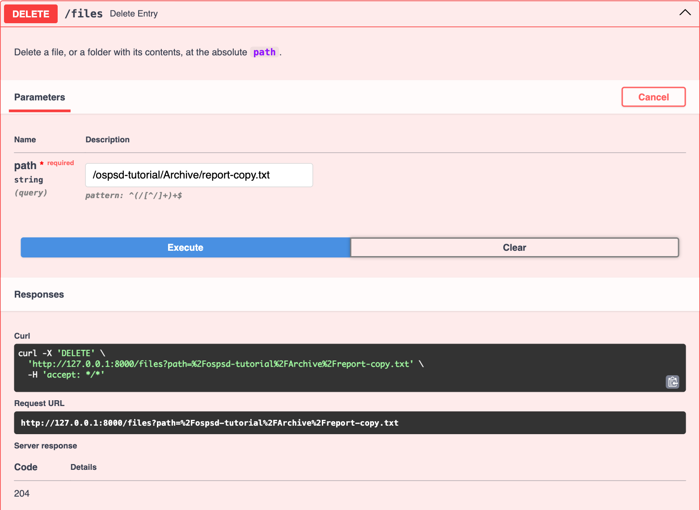

### 4.2 Delete it again → `404`

- **Expected:** `404 not_found`; delete is not idempotent.
- **Actual:** `404`, `"No file or folder at '/ospsd-tutorial/Archive/report-copy.txt'"`.

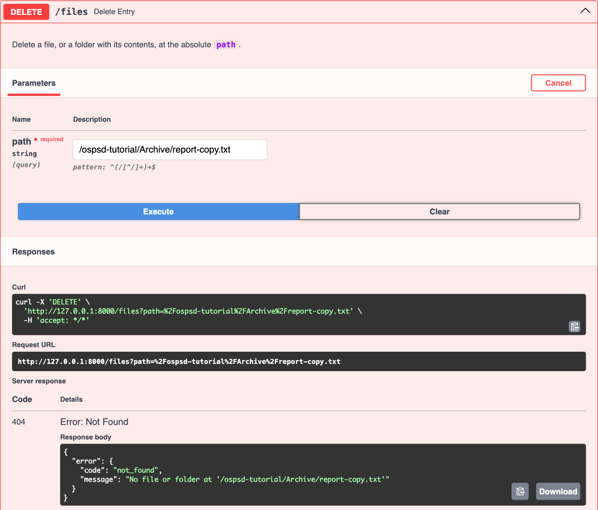

### 4.3 Delete with a relative path → `422` (curl)

Swagger UI checks the `path` pattern in the browser and won't send this request, so this step uses curl to show the server's own answer:

```bash
curl -X DELETE "http://127.0.0.1:8000/files?path=relative/report.txt"
```

- **Expected:** `422 invalid_input`; Dropbox is not contacted.
- **Actual:**
  ```json
  {"error": {"code": "invalid_input", "message": "query.path: String should match pattern '^(/[^/]+)+$'"}}
  ```

---

## 5. Failure logs

Every failed request is logged once as a structured warning on the `cloud_storage_service.errors` logger, which you can see in the terminal running `uvicorn`. These are the actual lines from the run above:

```text
Request failed: operation='upload_file' status=409 code='conflict' provider_failure=False reason="Something already exists at '/ospsd-tutorial/Docs/report.txt'"
Request failed: operation='create_folder' status=409 code='conflict' provider_failure=False reason="Something already exists at '/ospsd-tutorial/Archive'"
Request failed: operation='copy_entry' status=422 code='invalid_input' provider_failure=False reason="Cannot copy '/ospsd-tutorial/Docs' into itself: '/ospsd-tutorial/Docs/Backup' is inside the source"
Request failed: operation='move_file' status=404 code='not_found' provider_failure=False reason="No file or folder at '/ospsd-tutorial/Docs/summary.txt'"
Request failed: operation='rename_file' status=409 code='conflict' provider_failure=False reason="Something already exists at '/ospsd-tutorial/Archive/report-copy.txt'"
Request failed: operation='move_file' status=422 code='invalid_input' provider_failure=False reason="Cannot move '/ospsd-tutorial/Archive' into itself: '/ospsd-tutorial/Archive/Old' is inside the source"
Request failed: operation='delete_entry' status=404 code='not_found' provider_failure=False reason="No file or folder at '/ospsd-tutorial/Archive/report-copy.txt'"
Request failed: operation='delete_entry' status=422 code='invalid_input' provider_failure=False reason="query.path: String should match pattern '^(/[^/]+)+$'"
```

Each line names the operation, status, error code, and whether Dropbox caused the failure (`provider_failure`). Logs never include tokens, and validation failures don't echo the rejected value.

## 6. Clean up

`DELETE /files` with `path` = `/ospsd-tutorial` removes the scratch folder and everything left in it.

- **Expected:** `204`.
- **Actual:** `204`.

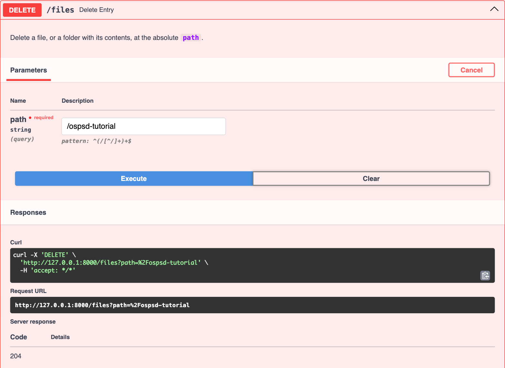

To disconnect this machine from Dropbox afterwards, run `uv run python -m dropbox_client_impl logout`.
